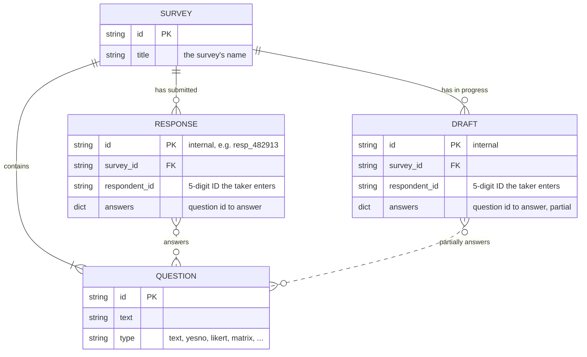

# Survey Manager: Key Data at a Glance

A survey holds its questions. Responses and drafts belong to one survey and
hold answers keyed by question id. A draft is a response that isn't finished
yet. See [data-model.md](data-model.md) for every field and how each is stored.

**How to read it:** `||--|{` means one survey contains one or more questions.
`||--o{` means one survey has zero or more responses, and zero or more drafts.
The dotted lines mean responses and drafts point to questions by putting each
question's id in their `answers` keys.
