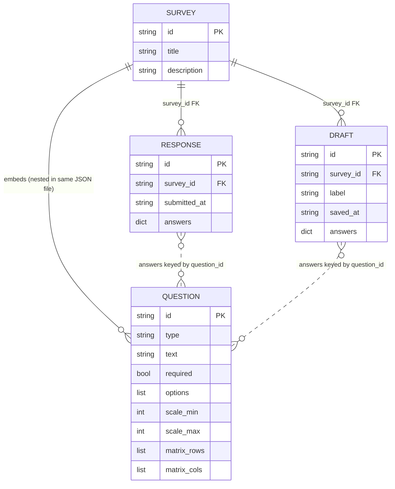

# Survey Manager Data Model

Entities persisted by `src/storage.py` and their relationships, derived from
`src/models.py` and the storage functions themselves.

## Notes

This is file storage, not a database, so a few things the diagram above
can't show on its own:

- **`QUESTION` isn't a separate store.** It only exists nested inside a
  `SURVEY`'s own JSON file (`surveys/<survey_id>.json`) — there's no
  `questions/` directory and no `load_question`/`save_question` function.
  It's shown separately above only because `RESPONSE`/`DRAFT` answers
  reference `Question.id`, not because it's independently persisted.
- **`survey_id` is the actual foreign key, enforced by directory layout,
  not a constraint.** `save_response`/`save_draft` write to
  `data/responses/<survey_id>/<id>.json` and
  `data/drafts/<survey_id>/<id>.json` respectively — the FK is "which
  folder this file lives under," and nothing stops an orphaned
  response/draft folder from outliving a deleted survey (`delete_survey`
  cleans up `data/responses/<survey_id>/` but not
  `data/drafts/<survey_id>/`).
- **`answers` keys aren't always a plain `question_id`.** For a
  `matrix`-type question, each row gets its own entry keyed
  `f"{question_id}_matrix_{row_label}"` instead (see
  `build_response_answers_from_state` in `form_logic.py`) — so one matrix
  question can correspond to several `answers` entries.
